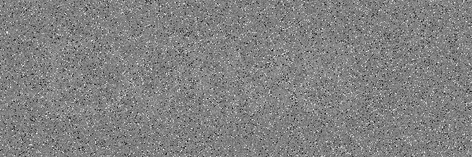
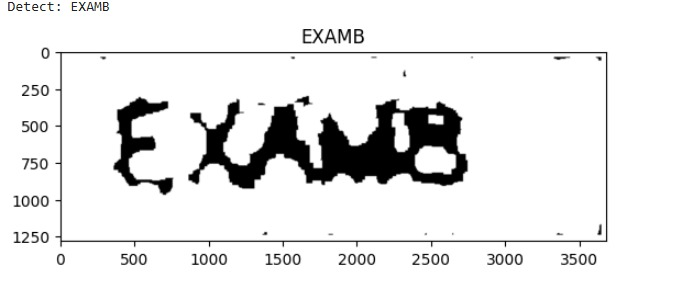

# Optical Character Recognition (OCR) on a Highly Degraded Image using OpenCV and PyTesseract

## 1. Project Overview

This project falls within the domain of computer vision applied to text extraction. It aims to recognize an isolated word from a highly degraded and noisy image (`exam_ultra_hard.png`), by combining image preprocessing techniques with OpenCV and the Optical Character Recognition (OCR) engine Tesseract, accessible in Python via the PyTesseract library.

The pipeline successively applies median filtering, automatic binarization using Otsu's method, morphological operations, upscaling, and border padding, before submitting the image to the OCR engine configured for a restricted alphanumeric vocabulary.

The objective is to implement an experimental image restoration approach applied to OCR, where the quality of preprocessing directly conditions recognition accuracy.

## 2. Objectives

The main objectives of the project are as follows:

- Load a degraded image and convert it to grayscale.
- Reduce impulse noise using median filtering while preserving character edges.
- Automatically binarize the image using Otsu's method, then invert its polarity.
- Enhance characters using morphological operations (dilation, opening).
- Upscale the image and add a border to facilitate reading by Tesseract.
- Restrict the OCR vocabulary to uppercase letters and digits, and adapt the segmentation mode.
- Extract the detected text and visualize the results in the notebook.

## 3. Main Features

### 3.1. Image Preprocessing

- **Grayscale Conversion** (`cv2.cvtColor`, `COLOR_BGR2GRAY`): reduces the image representation to a single channel to simplify subsequent processing.
- **Median Filtering** (`cv2.medianBlur`, 21 × 21 kernel): eliminates "salt and pepper" impulse noise while preserving character edges.
- **Otsu's Thresholding** (`cv2.threshold`, `THRESH_BINARY + THRESH_OTSU`): automatic binarization without a manual threshold.
- **Inversion** (`cv2.bitwise_not`): yields white characters on a black background, a polarity exploited by the following morphological operations.
- **Dilation** (`cv2.dilate`, 5 × 5 rectangular kernel, two iterations): thickens the strokes of white characters to enhance their visibility.
- **Morphological Opening** (`cv2.morphologyEx`, `MORPH_OPEN`): removes small parasitic white components and artifacts introduced by the processing.

### 3.2. Scaling and Border Padding

- **Upscaling** (`cv2.resize`, scale factor of 6 in x and y, `INTER_LINEAR`): increases the perceived size of characters, which improves recognition when the initial image has insufficient resolution.
- **Constant Border** (`cv2.copyMakeBorder`, 40 pixels on all four sides, `BORDER_CONSTANT`, `value=255`): isolates the text from the image edges to limit recognition errors for characters located at the periphery. The border color is defined by the `value` parameter (here white) and must remain consistent with the polarity of the image submitted to Tesseract.

### 3.3. OCR Engine Configuration

PyTesseract is called with the following configuration:

```text
--oem 1 --psm 8 -c tessedit_char_whitelist=ABCDEFGHIJKLMNOPQRSTUVWXYZ0123456789
```

The details of the parameters are presented in Section 6. The returned text is cleaned (removal of spaces and line breaks via `strip()`).

### 3.4. Results Visualization

The processing produces the following visualizations in the notebook:

- The preprocessed binary image, before upscaling.
- The final image submitted to the OCR, with the detected text displayed as a title.
- The detected text printed in the console.

On the studied image, the pipeline produced the following raw output:

```text
Detected text: EXAMB
```

This result corresponds to the output obtained during the pipeline execution on the image used in this project. It should be compared with the ground truth (see Section 10.2).

#### Results: Before / After

<table>
  <tr>
    <th align="center">Original image</th>
    <th align="center">Processed image</th>
  </tr>
  <tr>
    <td align="center">
      
    </td>
    <td align="center">
      
    </td>
  </tr>
</table>

## 4. Technical Architecture

The processing pipeline is organized into several successive steps.

### Step 1: Image Acquisition

Reading the image `exam_ultra_hard.png` via `cv2.imread`.

### Step 2: Grayscale Conversion

Reducing the image to a single channel (`COLOR_BGR2GRAY`).

### Step 3: Noise Reduction

Median filtering with a 21 × 21 kernel.

### Step 4: Binarization and Inversion

Automatic Otsu thresholding followed by inversion (`bitwise_not`).

### Step 5: Morphological Operations

Dilation (5 × 5 rectangular kernel, two iterations) then morphological opening with the same kernel.

### Step 6: Upscaling and Border

Resizing with a factor of 6 (linear interpolation), then adding a constant white border of 40 pixels on all four sides.

### Step 7: OCR Inference and Display

Calling `pytesseract.image_to_string` with the defined configuration, cleaning the output, and visualizing via Matplotlib.

## 5. Technologies Used

| Technology | Usage |
|---|---|
| Python | Main project language |
| Jupyter Notebook | Development and interactive execution of the pipeline |
| OpenCV | Preprocessing (grayscale, filtering, thresholding, morphology, resizing, border) |
| NumPy | Representation and manipulation of image matrices |
| PyTesseract (Tesseract OCR) | Optical Character Recognition |
| Matplotlib | Visualization of intermediate steps and final result |
| Pillow | Used internally by PyTesseract for image conversion |

## 6. Tesseract Configuration Parameters

| Parameter | Value | Role |
|---|---|---|
| `--oem` | 1 | Selects the recognition engine based on Tesseract's LSTM neural networks |
| `--psm` | 8 | Indicates that the image contains a single word |
| `-c tessedit_char_whitelist` | A–Z, 0–9 | Restricts allowed characters to uppercase letters and digits, to reduce detections of unwanted symbols |

Note: the code contains an alternative configuration tested and then discarded (`--psm 6` with a whitelist limited to digits), which failed to detect the digit "8" present in the image. This point illustrates the OCR engine's sensitivity to the segmentation mode and the allowed vocabulary.

## 7. Prerequisites

To run the project, the following elements are required:

- Python 3.8 or a later version.
- pip for dependency installation.
- Jupyter Notebook or JupyterLab.
- Python libraries: `opencv-python`, `pytesseract`, `numpy`, `matplotlib` (Pillow is installed as a dependency of PyTesseract).
- The **Tesseract OCR engine installed at the system level** and accessible from the PATH.
- The image `exam_ultra_hard.png` available next to the notebook.

## 8. Installation and Execution

### 8.1. Project Retrieval

Clone the Git repository:

```bash
git clone <REPOSITORY_URL>
```

Navigate to the project folder:

```bash
cd ocr_pipeline
```

Replace `<REPOSITORY_URL>` with the actual GitHub repository address.

### 8.2. Dependency Installation

Install the Python dependencies:

```bash
pip install opencv-python pytesseract numpy matplotlib
```

Or, if a `requirements.txt` file is present:

```bash
pip install -r requirements.txt
```

### 8.3. Tesseract OCR Installation

The Tesseract engine must be installed separately, at the system level:

- **Windows**: download the installer from the [UB-Mannheim Tesseract](https://github.com/UB-Mannheim/tesseract/wiki) repository, then verify that the installation folder is added to the PATH.
- **Linux**:

```bash
sudo apt-get install tesseract-ocr
```

- **macOS**:

```bash
brew install tesseract
```

Verify the installation:

```bash
tesseract --version
```

### 8.4. Notebook Launch

Start Jupyter Notebook:

```bash
jupyter notebook
```

Open the `ocr_pipeline.ipynb` file and execute the cells in the intended order.

Before execution, verify the following elements:

- The presence of the `exam_ultra_hard.png` image at the path expected by the code.
- The accessibility of Tesseract from the PATH (otherwise, define `pytesseract.pytesseract.tesseract_cmd` in the notebook).
- The correct installation of Python dependencies.

## 9. Project Structure

The current repository structure is as follows:

```text
ocr_pipeline/
├── ocr_pipeline.ipynb     # Notebook containing the pipeline and visualizations
├── exam_ultra_hard.png    # Degraded source image (before) used by the code
├── processed_image.png    # Processed image (after) used for the before/after comparison
├── README.md              # Project documentation
├── .gitattributes
└── .gitignore
```

Description of the elements:

- `ocr_pipeline.ipynb`: Jupyter notebook containing the code, processing steps, and project visualizations.
- `exam_ultra_hard.png`: highly degraded and noisy source image processed by the pipeline (before).
- `processed_image.png`: image resulting from the preprocessing stage, used for the before/after comparison in Section 3.4 (after).
- `README.md`: project documentation.
- `.gitattributes` / `.gitignore`: Git configuration files.

Note: the pipeline code itself does not export any processed image (no call to `cv2.imwrite`). The `processed_image.png` file present in the repository is an artifact exported manually from the notebook, provided for documentation and visualization purposes.

## 10. Limitations and Improvement Perspectives

### 10.1. Parameters Calibrated for a Single Image

The pipeline values (median kernel 21, morphological kernel 5 × 5, two iterations, upscale factor 6, 40-pixel border) are fixed and adjusted for the studied image. Their generalization to other images is not guaranteed. Automating the parameter selection (grid search, adaptive selection) would constitute a notable improvement.

### 10.2. Character Confusions

The whitelist reduces false characters but does not eliminate typical visual confusions ("8"/"B", "0"/"O", "1"/"I"). The comment present in the code suggests that an "8" in the image is difficult to detect, the "EXAMB" output possibly corresponding to such a confusion. Exploiting confidence scores (`pytesseract.image_to_data`) and voting between multiple PSM configurations would make the result more reliable.

### 10.3. Restricted Use Case

The `--psm 8` mode assumes an image containing a single word. Extending the pipeline to multi-word or multi-line images (modes `--psm 6` or `--psm 3`) and to batch image processing would broaden the project's scope.

### 10.4. Lack of Quantitative Evaluation

No performance metrics are calculated. A systematic comparison with the ground truth (Character Error Rate and Word Error Rate) on a set of degraded images would allow objectively evaluating the pipeline.

### 10.5. Polarity and Border

The polarity after inversion and the border color are set manually. Automatic polarity detection (proportion of black and white pixels) would make the pipeline robust to different types of input images.

### 10.6. Advanced Preprocessing Techniques

Other avenues could be explored: non-local denoising (`cv2.fastNlMeansDenoising`), super-resolution, or deep learning methods (denoising autoencoders). A comparison with alternative OCR engines (EasyOCR, PaddleOCR) would complete the study.

### 10.7. Code Robustness

The code does not verify the success of the image reading (`cv2.imread` silently returns `None` if the file is missing) nor the availability of the Tesseract binary. Adding checks and explicit error messages would improve the execution experience.

## 11. Conclusion

This project illustrates the integration of image preprocessing techniques and an OCR engine in a text recognition scenario on a degraded image.

The combination of median filtering, Otsu binarization, morphological operations, and a restricted Tesseract configuration allows studying how preprocessing quality influences recognition accuracy.

This architecture provides an experimental foundation for further exploration of topics such as quantitative OCR evaluation, character confusion management, and generalization to more varied image datasets.

## 12. Author

<div align="center">

<table>
<tr>
<td align="center">
<a href="https://github.com/mohammed-boujaada">

<br/>
<sub><b>Mohammed Boujaada</b></sub>
</a>
<br/>
MIATE Master's — FSA Nador
<br/>
<a href="https://github.com/mohammed-boujaada">

</a>
<a href="https://www.linkedin.com/in/mohammed-boujaada-229a3333a/">

</a>
</td>
</tr>
</table>

</div>

**Institution**: FSA Nador — Master's in Artificial Intelligence & Emerging Technologies  
**Module**: Computer Vision  
**Academic Year**: 2025 - 2026